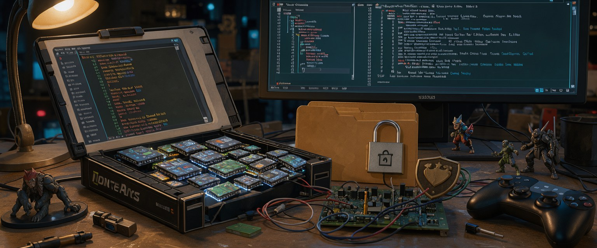

# modwright



Mod any PC game safely and prove the mod works. A Claude Code plugin with one skill and a standard-library script.

- Finds the engine and runtime (Unity Mono or IL2CPP, Unreal, Godot, GameMaker, Source and more) and the loader to use.
- Stops at anti-cheat (EAC, BattlEye, Vanguard...): no injection, no memory patching, no online cheats.
- Backs up saves and every file it will touch with SHA-256 hashes, and restores or verifies them later.
- Decompiles before naming a patch target, never guesses a method name.
- Proves a mod loaded from the loader log (BepInEx, MelonLoader, UE4SS, UMM), and flags errors and stale logs.
- Prepares a Steam Workshop VDF or Thunderstore manifest without uploading.

Not for Minecraft (minewright), Roblox (roblox-agent) or MADNESS Project Nexus (madnesswright).

## Install

Clone the repo and add its parent folder as a local Claude Code marketplace, or copy `skills/modwright` into your own plugin.

## Use

Ask in plain words: "mod this game", "which mod loader should I use", "back up my saves before modding", "did my mod load", "upload my mod to the Workshop". The script runs on its own too:

```
python skills/modwright/scripts/mw.py scan "C:/Games/MyGame"
python skills/modwright/scripts/mw.py backup backups/1 "C:/Users/me/AppData/LocalLow/Co/Game" --build 123456
python skills/modwright/scripts/mw.py restore backups/1 --verify
python skills/modwright/scripts/mw.py proof "C:/Games/MyGame" --mod CoolMod
python skills/modwright/scripts/mw.py publish-prep thunderstore mymod --version 1.0.0 --title CoolMod
```

## License

MIT. See [LICENSE](LICENSE).
